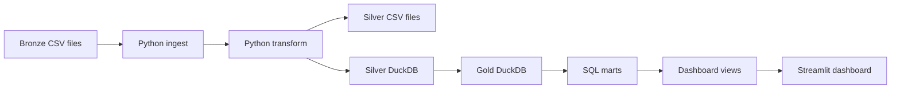

# Strikes on Ukraine Analytics

Analytics project for exploring reported missile and UAV strike activity in the war in Ukraine. The project builds a lightweight local data pipeline with Python, DuckDB, SQL, and Streamlit, then serves dashboard-ready marts through an interactive web app.

- Live dashboard: [https://air-strikes-on-ukraine-dashboard.streamlit.app/](https://air-strikes-on-ukraine-dashboard.streamlit.app/)
- Product Backlog: [Google Sheets backlog](https://docs.google.com/spreadsheets/d/1dJnwIyfNNKBvxQJa0GBG62zLGKrf48YhoRG3_N_p24s/edit?usp=sharing)

The dashboard focuses on:

- strike activity trends over time
- launched and destroyed totals by weapon model and weapon type
- target area summaries and approximate centroid maps
- air defense success percentage by area

## Project Status

This project is under active development and deployed on Streamlit Community Cloud. The current version is a local and deployed MVP with a bronze/silver/gold data structure, DuckDB marts, and a Streamlit dashboard.

Data files and generated databases are intentionally not committed to Git. The deployed dashboard downloads a verified, approved Gold database from a GitHub Release. The local pipeline can still be run separately for development.

## Data Source And License

This project uses the Kaggle dataset [Massive Missile Attacks on Ukraine](https://www.kaggle.com/datasets/piterfm/massive-missile-attacks-on-ukraine/data) by Kaggle user [piterfm](https://www.kaggle.com/piterfm).

The dataset is licensed under [Creative Commons Attribution-NonCommercial-ShareAlike 4.0 International](https://creativecommons.org/licenses/by-nc-sa/4.0/).

The original data has been transformed for this project. Changes include column normalization, date parsing, weapon reference enrichment, target area normalization, DuckDB silver/gold tables, and derived dashboard metrics such as air defense success percentage.

This project is intended for non-commercial educational and portfolio use.

The code in this repository and the dataset are licensed separately. The source dataset and any redistributed derived data outputs are based on the Kaggle dataset by piterfm and should keep the same CC BY-NC-SA 4.0 license and attribution.

## Tech Stack

- Python 3.12
- pandas for data cleaning and transformation
- DuckDB for local analytical storage
- SQL for dashboard marts and views
- Streamlit for the dashboard
- Plotly and PyDeck for charts and maps
- Kaggle API for source data download
- Poetry for local dependency management

## Data Flow



## Data Layers

### Bronze

`data/bronze/` contains the original source CSV files.

You can download the files with:

```bash
poetry run download-data
```

Expected local files after download:

```text
data/bronze/missile_attacks_daily.csv
data/bronze/missiles_and_uavs.csv
```

### Silver

`data/silver/` contains cleaned and normalized data. The pipeline currently writes both CSV files and a DuckDB database here.

Main outputs:

```text
data/silver/attacks_clean.csv
data/silver/attacks_regions.csv
data/silver/weapon_reference_clean.csv
data/silver/silver.duckdb
```

### Gold

`data/gold/` contains the analytics-ready DuckDB database used by the dashboard.

Main output:

```text
data/gold/gold.duckdb
```

The gold database contains physical mart tables and dashboard-facing views.

## Main Gold Tables

The gold layer is split into summary marts in `sql/marts.sql`, daily marts in `sql/daily_marts.sql`, and dashboard-facing views in `sql/views.sql`.

### Summary marts

| Mart | Purpose |
| --- | --- |
| `mart_overview_summary` | One-row KPI summary for the overview page |
| `mart_daily_activity` | Daily launched and destroyed totals with rolling averages for overview trends |
| `mart_weapon_model_summary` | Weapon model totals, reference coverage, and first/last seen dates |
| `mart_weapon_type_summary` | Aggregated weapon category and weapon type totals |
| `mart_area_macro_summary` | Area macro and target scope totals |
| `mart_directional_macro_summary` | Coarse directional macro map summary |
| `mart_region_activity` | Reporting-region summary for the specific region map |

### Daily marts

Daily marts live in the `daily` schema inside `gold.duckdb`.

| Mart | Grain | Purpose |
| --- | --- | --- |
| `daily.mart_weapon_model_daily` | `event_date + weapon_model` | Date-range rollups for weapon model charts and analysis |
| `daily.mart_weapon_type_daily` | `event_date + weapon_category + weapon_type` | Date-range rollups for weapon type summaries |
| `daily.mart_area_macro_daily` | `event_date + area_macro + target_scope` | Date-range rollups for area summaries |
| `daily.mart_directional_macro_daily` | `event_date + area_macro` | Daily directional macro map support |
| `daily.mart_region_daily` | `event_date + reporting_region` | Daily region map support with allocated and exploded totals |

### Dashboard views

The Streamlit app reads the `vw_dashboard_*` views instead of querying raw mart names directly.

| View | Source |
| --- | --- |
| `vw_dashboard_overview` | `mart_overview_summary` |
| `vw_dashboard_daily_activity` | `mart_daily_activity` |
| `vw_dashboard_weapon_models` | `mart_weapon_model_summary` |
| `vw_dashboard_weapon_types` | `mart_weapon_type_summary` |
| `vw_dashboard_area_macros` | `mart_area_macro_summary` |
| `vw_dashboard_directional_macros` | `mart_directional_macro_summary` |
| `vw_dashboard_region_map` | `mart_region_activity` |
| `vw_dashboard_weapon_models_daily` | `daily.mart_weapon_model_daily` |
| `vw_dashboard_weapon_types_daily` | `daily.mart_weapon_type_daily` |
| `vw_dashboard_area_macros_daily` | `daily.mart_area_macro_daily` |
| `vw_dashboard_directional_macros_daily` | `daily.mart_directional_macro_daily` |
| `vw_dashboard_region_map_daily` | `daily.mart_region_daily` |

## How The Code Works

```text
src/ingest.py         Reads raw bronze CSV files.
src/download_data.py  Downloads the source dataset from Kaggle into the bronze layer.
src/transform.py      Cleans columns, parses dates, normalizes weapon models, and maps targets to regions.
src/load.py           Writes silver CSV/DuckDB outputs and builds the gold DuckDB database.
src/pipeline.py       Runs the full bronze -> silver -> gold pipeline.
sql/marts.sql         Builds summary gold mart tables.
sql/daily_marts.sql   Builds date-grained marts in the `daily` schema.
sql/views.sql         Creates stable dashboard-facing views.
dashboard/data.py     Opens read-only DuckDB connections for Streamlit queries.
dashboard/date_queries.py Aggregates filtered dashboard queries from daily views.
app.py                Streamlit navigation entrypoint.
pages/                Streamlit pages for overview, weapons, areas, and analysis.
notebooks/            Local exploration notebooks.
```

Do not run the pipeline with `python src/pipeline.py`. The project uses package imports, so run it with Poetry or as a module.

## Local Setup With Poetry

Install dependencies:

```bash
poetry install
```

### Development and tests

Use Python 3.12 or newer and install the development dependencies with:

```bash
poetry install --with dev
poetry run pytest
```

The test data in `tests/fixtures/` is synthetic. The `isolated_data_dir` pytest
fixture copies it to a temporary directory and redirects pipeline input and output
there. Tests using this fixture do not need Kaggle credentials or network access
and do not overwrite the project's `data/` files. Keep future tests that run the
pipeline on this fixture (or provide equivalent isolation).

For Streamlit Cloud, `requirements.txt` is the dependency file used for installation;
Poetry uses `pyproject.toml` and `poetry.lock` locally. Keep the main dependency
version ranges in both files aligned when changing dependencies. The lock file pins
local Poetry installs, while Cloud can select a different version within the ranges;
matching ranges alone does not guarantee identical environments. Python versions
can differ as well. When changing dependencies, run `poetry lock` as needed, commit
the lock file, and check that the Cloud deployment still installs and starts.

GitHub Actions runs the tests on pushes and pull requests using Poetry on Python
3.12 and separately using `requirements.txt` on Python 3.14, matching the Python
version currently configured in Streamlit Cloud. The Cloud dependency job also
checks that the Kaggle API can be imported without real credentials. These checks
do not test Kaggle authentication, download live data, or verify the deployed app.
If the Cloud Python version changes, update the workflow to match it.

### Approved data releases

#### Test latest Kaggle data locally without publishing

Configure Kaggle API credentials locally using the Kaggle CLI instructions, then run the candidate build and dashboard checks:

```powershell
poetry install --with dev
poetry run python -m pip install -r monitoring/requirements.txt
poetry run python -m playwright install chromium
poetry run python -m scripts.test_release_locally
```

The command first runs the full pytest suite, downloads the latest Kaggle dataset into a fresh ignored `.local-data-tests/run-*` directory, builds and validates a candidate there, then starts Streamlit on localhost and runs the browser smoke test. Download errors fail the run; it does not fall back to older data. It does not contact GitHub, create releases, or modify your normal Bronze, Silver or Gold files. The downloaded data, candidate, screenshots and Streamlit log remain in the printed output directory for inspection; remove old test directories when no longer needed. To use an existing snapshot without downloading, add `--data-dir C:\path\to\bronze`; use `--skip-browser` only when you deliberately want to skip page checks. If Chromium is already installed elsewhere, set `PLAYWRIGHT_BROWSER_EXECUTABLE` to its executable path instead of installing Playwright's browser.

The browser check currently has a known limitation: it waits for page titles and a fixed delay, which may miss errors occurring later. Independent review also identified unresolved release compatibility and recovery issues; a passing local test does not mean the current workflow is ready to publish or deploy.

The **Build and publish approved data** workflow runs every other UTC day and supports manual runs. It downloads Kaggle data to the runner's temporary directory, validates the source, builds Gold, runs the dashboard queries and checks all four pages in Chromium. Only after these checks pass does it publish `gold.duckdb`, `gold.duckdb.sha256` and `metadata.json` as a `data-*` GitHub Release. Raw CSVs are not committed or uploaded. The Gold database currently also contains copies of Silver-level tables, so publishing it redistributes those records.

Before the first publication, check the dataset page and any upstream notices for the current license and permission to redistribute these derived and Silver-level records. The README's existing CC BY-NC-SA 4.0 description has not been independently verified from Kaggle's live license display. Once confirmed, add the repository Actions variable `DATA_LICENSE_CONFIRMED` with value `true`; without it publication fails. Keep the attribution, license link and description of changes in this README with every release. Add `KAGGLE_API_TOKEN` as an Actions secret, and ensure Actions has permission to create releases. Scheduled failures use GitHub Actions notifications; configure those in GitHub.

At startup Streamlit downloads the latest published `data-*` release and verifies the checksum. An already downloaded copy is used offline only if its saved checksum matches. A new release is selected on process restart; no Kaggle download or transformation runs in Streamlit. If no verified copy is available, the app shows an error. The first release must exist before deploying this version. The checksum checks integrity, not the trustworthiness of the publisher.

For rollback, download the known-good release assets, verify their checksum, create a **new** `data-*` release with those assets and restart Streamlit; retain the original metadata to make the rollback traceable. The database and checksum assets must be named `gold.duckdb` and `gold.duckdb.sha256`. For local development with a database you built yourself, set `DASHBOARD_GOLD_DB` to its absolute path before starting Streamlit. This explicit override also lets the candidate browser test use exactly the file being tested.

### Deployed dashboard monitoring

The **Monitor deployed dashboard** GitHub Actions workflow checks the deployed
overview every other UTC day, around 08:23 UTC, and can also be started with
**Actions → Monitor deployed dashboard → Run workflow**. Scheduled runs use
the default branch and can be delayed or skipped by GitHub. The workflow is
scheduled daily but skips alternate UTC days so the interval stays two days
across month boundaries; manual runs are never skipped.

The monitor opens the app in Chromium, requests wake-up when Streamlit shows
its sleeping page, and waits for the overview heading and `Launched total`
metric. It retries once on failure. Logs are available on the Actions run; on
failure it uploads screenshots as the `dashboard-monitor-failure` artifact for
seven days. It does not read private Streamlit Cloud logs or test every page,
and a successful check does not guarantee the data is current. Configure GitHub
Actions failure notifications in your GitHub notification settings.

The monitoring job uses Ubuntu 24.04 to match the pinned Playwright version.
When upgrading Playwright or the runner image, check their OS compatibility.

The default monitored URL is specified in `monitoring/check_dashboard.py`.
Set the `DASHBOARD_URL` environment variable to check a different deployment.
The monitor may take several minutes when the app has to wake up.

### Monitor failure analysis

When **Monitor deployed dashboard** fails, **Analyze dashboard monitor failure**
retrieves the failed steps' logs for that specific run and attempt and asks one
OpenAI Agents SDK agent to write a short English diagnosis. The report is in the
analysis run's GitHub Actions summary and the `monitor-failure-analysis` artifact
for seven days. The monitor's own GitHub failure notifications remain independent;
an optional SMTP notification can send the report to a separate address. The analysis uses at most one screenshot
from the matching run attempt, preferring `failure-2.png` over `failure-1.png`.
If the screenshot is missing, expired, too large, or cannot be matched to the
attempt unambiguously, the analysis continues with logs only. It does not access
private Streamlit Cloud logs or modify the repository.

To enable analysis, configure a billable OpenAI API project and a model available
to it, then add `OPENAI_API_KEY` under the repository's **Settings → Secrets and
variables → Actions → New repository secret**. Never commit the key or put it in
logs. The default model is `gpt-6-luna`; API use is billed separately from Codex
subscription usage. Limit spending in the OpenAI Platform billing settings.
Without a valid key or model access the analysis fails with a generic message; the
original monitor result is unaffected.

Once this workflow is in the default branch, test it from **Actions → Analyze
dashboard monitor failure → Run workflow** using the numeric ID of a previous
failed **Monitor deployed dashboard** run. Manual runs analyze its latest attempt;
automatic runs analyze the triggering attempt. The workflow only accepts completed,
failed scheduled or manually triggered monitor runs from this repository. A
successful monitor run is not analyzed. Only the last 40,000 bytes of failed-step
logs are sent for analysis, after basic token redaction; review logs for sensitive
information because automated redaction cannot guarantee removal of every secret.
If a screenshot is available it is sent to the model too; screenshots are not
redacted and may contain sensitive information. Image input adds to API usage.
The report is an AI-generated assessment, not a verified root cause.

#### Optional email notification

Configure an authenticated SMTP provider that supports STARTTLS (normally port
587). Add these repository secrets under **Settings → Secrets and variables →
Actions**:

| Secret | Purpose |
| --- | --- |
| `SMTP_HOST` | SMTP server host name |
| `SMTP_USERNAME` | SMTP login name |
| `SMTP_PASSWORD` | Provider-issued SMTP password or app password |
| `ALERT_EMAIL_TO` | One recipient address; it can differ from your GitHub address |
| `SMTP_PORT` | Optional STARTTLS port; defaults to `587` |
| `SMTP_FROM` | Optional sender address; defaults to `SMTP_USERNAME` |

The sender address must be accepted by the chosen SMTP provider. Do not use a
regular account password if the provider requires an app-specific password or
API credential. If none of the required settings is present, email is skipped;
partially configured settings or a delivery error make the email step fail. The
email contains the text report and analysis-run link, not the screenshot. If the
analysis fails, a brief fallback notification is sent when possible. The branch
integration test also sends an email once configured. No credentials or addresses
need to be committed or shared in chat. A provider can impose its own delivery
limits or charges. GitHub's original failure email remains independent.

If log collection or agent startup fails, the workflow still attempts to send a
fallback email with links to the monitor and analysis runs. When possible it
identifies the failure category, such as an API authentication error or timeout,
without including provider error details or secrets. The email cannot be guaranteed
if the workflow never starts, is terminated before the notification step, or the
SMTP connection fails; keep GitHub Actions failure notifications enabled as a
separate alert.

Configure Kaggle API credentials before downloading the source data. Create a Kaggle API token in your Kaggle account settings and configure it locally according to the Kaggle CLI instructions. If you keep credentials inside the project, use a `.kaggle/` directory; it is ignored by `.gitignore`.

Download the source CSV files:

```bash
poetry run download-data
```

Run the full pipeline:

```bash
poetry run pipeline
```

Start the dashboard using your locally built database (PowerShell):

```powershell
$env:DASHBOARD_GOLD_DB = (Resolve-Path 'data/gold/gold.duckdb').Path
poetry run streamlit run app.py
```

The dashboard runs locally in your browser, usually at:

```text
http://localhost:8501
```


## Querying The DuckDB Database

After running the pipeline, you can inspect the gold database directly from Python:

```python
import duckdb

connection = duckdb.connect("data/gold/gold.duckdb", read_only=True)

print(connection.execute("SHOW TABLES").fetchdf())
print(connection.execute("SELECT * FROM vw_dashboard_overview").fetchdf())

connection.close()
```

This is useful in notebooks before adding new charts to Streamlit.

## Important Metric Definitions

- `Strike records` means rows in the cleaned attack dataset. It should not automatically be interpreted as a perfectly deduplicated count of real-world attacks.
- `Launched total` means the reported number of launched weapons in the source data.
- `Destroyed total` means the reported number of destroyed weapons in the source data.
- `Air defense success %` is calculated as `destroyed_total / launched_total * 100`.
- Region maps use approximate centroid coordinates, not exact strike locations or official geographic boundaries.
- Some source rows are nationwide or unknown, so not all launched volume can be placed on a specific map point.
- Multi-region rows can be viewed as exploded totals or allocated totals. Allocated totals divide launched and destroyed values across the listed regions to reduce double counting in region-level comparisons.

## Project Structure

```text
ukrane-war-drone-analytics/
|-- app.py
|-- dashboard/
|   `-- data.py
|-- data/
|   |-- bronze/
|   |-- silver/
|   `-- gold/
|-- notebooks/
|-- pages/
|   |-- overview.py
|   |-- 1_Weapons.py
|   |-- 2_Areas.py
|   `-- 3_Analysis.py
|-- sql/
|   |-- marts.sql
|   |-- daily_marts.sql
|   `-- views.sql
|-- src/
|   |-- download_data.py
|   |-- ingest.py
|   |-- load.py
|   |-- pipeline.py
|   `-- transform.py
|-- pyproject.toml
|-- requirements.txt
`-- README.md
```

## Data Limitations

This project depends on public source data. Before publishing or redistributing derived data, document:

- original data source and license: Kaggle dataset by piterfm, CC BY-NC-SA 4.0
- update frequency
- known missing values
- whether source rows represent attacks, reports, or weapon launch events
- how nationwide, unknown, and multi-region target values are handled
- limitations of approximate map centroids


## Future Improvements

- Add data quality checks for nulls, duplicate rows, and impossible values.
- Add tests for transform logic and SQL mart assumptions.
- Add a source documentation page to the dashboard.
- Add GitHub Actions for scheduled pipeline runs.
- Add more geographic validation for region mapping.
- Add screenshots and architecture images to `docs/`.

## Portfolio Summary

Built an end-to-end strike analytics project using Python, SQL, DuckDB, and Streamlit. Designed a local medallion-style data pipeline to ingest public CSV data, clean and normalize weapon and target fields, create analytics-ready DuckDB marts, and serve interactive dashboard pages for trend, weapon, area, and air defense analysis.
